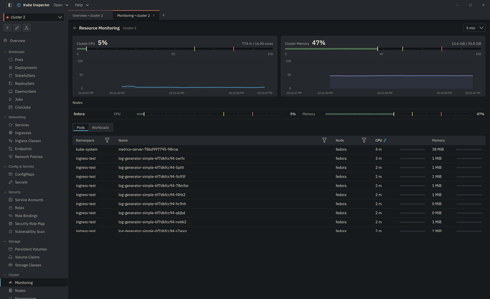

# Monitoring

The Monitoring screen is a live resource-usage dashboard for the cluster, built from **metrics-server**.

!!! warning "Requires metrics-server"
    Usage data comes from the Kubernetes metrics API. If [metrics-server](https://github.com/kubernetes-sigs/metrics-server) is not installed in the cluster, the screen shows a notice and no charts. Capacity (but not usage) may still be shown.

{ .doc-shot }

## What's on screen

- **Cluster summary** — total CPU and memory used vs. capacity, with a rolling usage trend.
- **Nodes** — per-node CPU and memory usage bars (scrollable when there are many nodes).
- **Top consumers** — a sortable, filterable table; switch between **Pods** and **Workloads** (Deployments/StatefulSets etc., aggregated from their pods). Each row shows CPU and memory with a bar relative to cluster capacity.

## Drill-down

Click any node, pod or workload row to open a detail drawer with:

- CPU and memory **trend charts** over the selected time window.
- For a **pod**: a per-container usage breakdown.
- For a **workload**: its member pods (click one to drill into it).
- For a **node**: the pods running on it (click one to drill in).

## Time window

The **time-window** dropdown (5 min → 2 hours) scales every chart to that range.

!!! note "History is live and in-memory"
    Trends are accumulated while the screen is open (polled every few seconds) and kept in memory only — they reset when the app restarts. There is no long-term/historical store.
