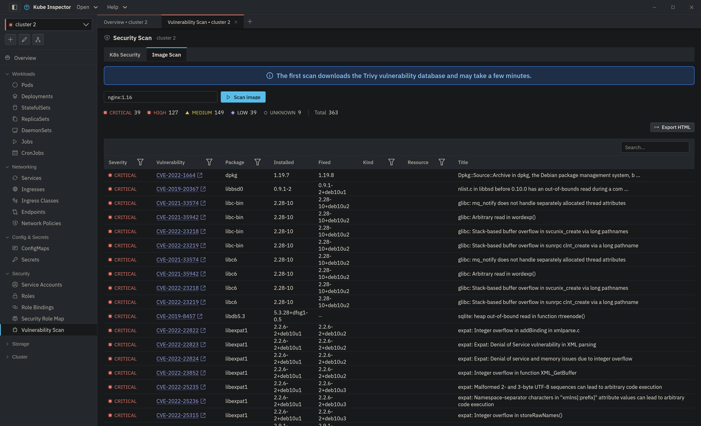

# Vulnerability Scan

The Vulnerability Scan screen scans your cluster for image vulnerabilities, misconfigurations and hardcoded secrets using an embedded [Trivy](https://trivy.dev) engine — no external `trivy` binary required.

{ .doc-shot }

The screen has two tabs: **K8s Security** scans the whole cluster, **Image Scan** scans one image you type in (for example `nginx:1.25`).

## Scanning a cluster

Press **Scan cluster**. The scan runs in the app's backend, so closing the panel does not stop it: reopen the screen and it reconnects to the scan in progress. Each distinct image is scanned once, however many workloads use it. Misconfigurations and secrets are scanned in parallel with the images.

**Stop** cancels the scan. Images still waiting in the queue stop immediately; an image that is already downloading finishes its current layer first, so the button reads *Stopping…* for a moment. A cancelled scan is not saved.

A finished scan is saved to the scan history and shown in four sections.

### Summary

The view for someone who needs the state of the cluster in a minute:

- Counters for **Critical**, **High**, **Fixable** and **Coverage**, each with the change since the scan you compare with (▲ or ▼).
- **Fixable** is the share of critical and high findings that have a fixed version.
- **Coverage** is how many images were scanned, and how many could not be.
- A one-sentence verdict: how many critical findings sit in workloads that are reachable from outside (a LoadBalancer or NodePort Service, or an Ingress), and how many critical and high findings the first fix plan items close.
- **Riskiest workloads**, ordered by exposure, then critical count, then high count, then privilege flags. There is no hidden score; each row shows why it ranks where it does (exposed, runs as root, privileged, hostPath mount, host network).
- **Changed in this scan**: new findings, closed findings and new workloads compared with the other scan.

A finding is counted once per image, CVE, package and package path. Ten workloads that run the same image do not multiply the number.

### Fix plan

Answers "what do I change, and what does it close?". The list is on the left, the selected item on the right, ordered by the critical findings it closes, then the high ones, then the number of exposed workloads affected.

| Item | What it means |
|---|---|
| Upgrade a package | One package at one installed version, with the highest fixed version in the group and the vulnerabilities it closes |
| Rebuild on a newer base | The image's OS packages carry fixable findings. The plan says to rebuild on a newer base of that OS and does not name a tag, because Trivy does not report one. An end-of-life OS is flagged. |
| Fix a misconfiguration | One Trivy check, with the affected workloads and Trivy's resolution text |

Findings without a fixed version are not listed as items; the list ends with how many open findings have no fix yet.

The detail pane shows the affected workloads. Selecting one opens its YAML, and **Accept risk** opens the accept dialog. When **AI suggestions** is on, an **Ask AI** button also appears.

### Findings

The full tables: **Misconfigs**, **Vulnerabilities** and **Secrets**. Findings that are new since the compared scan are marked, and **Only new** narrows each table to them. Accepted findings are hidden unless you switch on **Show accepted**. Select a row for its details, including references and the recommended fix.

Secret values are stored masked.

### Coverage

Which images were scanned and which were not, and why. A failed image is listed with a reason — the registry refused access, the image was not found, the scan timed out, or the pull secret could not be read — and the pull secret that was used, if any. The section also lists your accepted risks.

## Scan history and comparison

Each finished scan is kept under `~/.kube-ins/trivy-history/<cluster>/`: the last 20 scans per cluster. Use the **Scan** picker to open an older one and **Compare with** to pick the scan to compare against. The Summary deltas, the *new* marks and the changed list all follow that choice. Jobs owned by a CronJob appear under the CronJob's name, so a run of the same CronJob does not look like a new workload.

## Accepted risks

Some findings are fine to live with. **Accept risk** creates an exception for them, and accepted findings leave the counts and the fix plan.

- A vulnerability is accepted by CVE and image repository, for any tag of that image.
- A misconfiguration is accepted by check and workload.
- Secrets cannot be accepted. A leaked credential is rotated, not tolerated.
- A reason and an expiry date are required. The expiry defaults to 90 days.
- When an exception expires the findings count again, and the Coverage section marks it *expired*.

Exceptions are stored in `~/.kube-ins/trivy-exceptions/<cluster>.json` and are listed, and can be removed, in the Coverage section.

## Report

**Report** exports the selected scan as one HTML file. It prints to PDF from any browser. It has three parts, written for three readers:

1. **Summary**, for management.
2. **Fix plan**, for the developers who will do the work.
3. **Audit appendix**, for compliance: when the scan ran, the cluster and API server, the Trivy and vulnerability database versions, coverage, accepted risks, images that could not be scanned and why, and the full list of findings.

The report is written in the language the app is set to. The Image Scan tab has its own **Export HTML**.

## Private registries

Images from a private registry are scanned with the credentials of the pod's own `imagePullSecrets`, then those of its ServiceAccount. Only the one credential whose registry matches the image is used; it is never sent anywhere else. If the app is not allowed to read the secret, the image is listed in Coverage as *Pull secret not readable*. See [Privacy](../privacy.md) for exactly what is read and kept.

If no pull secret matches, Trivy also tries the local Docker login in `~/.docker/config.json`.

## AI suggestions

The **AI suggestions** switch is off by default, and the choice is remembered. When it is on, the fix plan detail shows **Ask AI**, which opens the AI assistant with a question already written for that item. It does not send the question — you read it and press Enter — and it needs [Ollama](https://ollama.com) like the rest of the assistant.

## Image Scan

Type an image reference, press **Scan image**, and get a table of its vulnerabilities:

| Column | Description |
|---|---|
| Severity | CRITICAL / HIGH / MEDIUM / LOW / UNKNOWN |
| Vulnerability | CVE id, linked to its [cve.org](https://www.cve.org) record |
| Package | Affected package |
| Installed | Installed version |
| Fixed | Version that fixes the issue (if any) |
| Title | Short description |

Image scans are not saved to the history.

!!! note "First scan downloads the vulnerability database"
    The first scan downloads Trivy's vulnerability database (a few hundred MB) into `~/.kube-ins/trivy-cache/`, so it can take a few minutes and needs internet access. Later scans reuse the cache.
