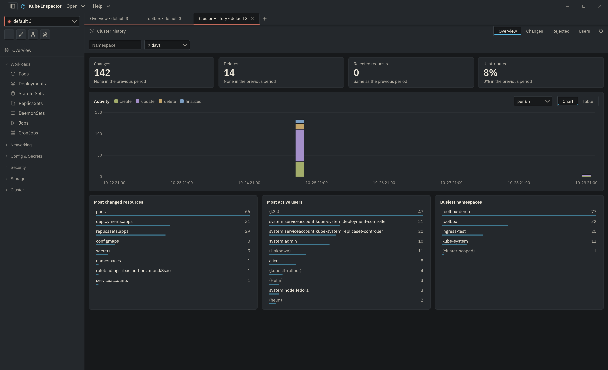
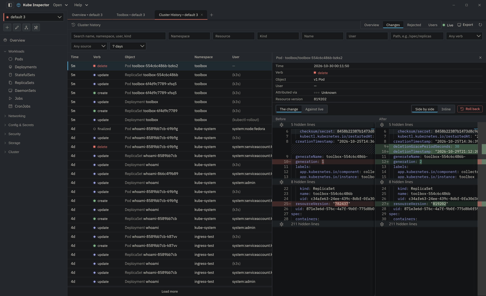

# Cluster History

**Toolbox ▸ Cluster history inspection ▸ Open.** The panel has four views:
**Overview**, **Changes**, **Rejected** and **Users**. Filters belong to the
panel and stay while it is open, also when you close and reopen the tab; they
reset when the app restarts.

## Overview

The panel opens here: what happened in the chosen period, compared with the
period of the same length before it.

{ .doc-shot }

- **Changes, Deletes, Rejected requests, Unattributed** — the headline counts,
  each against the previous period.
- **Activity** — changes per column, stacked by verb. The column width follows
  the range (an hour for a day, a day for a month) and can be changed in the
  corner. Hatched stretches are [recording gaps](recording-health.md#recording-gaps).
  **Table** shows the same counts as rows.
- **Most changed resources, most active users, busiest namespaces.**

Click a column, a table row or a list entry to open **Changes** filtered to it.

## Changes

Newest first, 100 at a time (**Load more** for older ones).

{ .doc-shot }

**Filters** run on toolbox, over everything it recorded: search (name,
namespace, user, kind), namespace, resource, kind, name, user, **path** (a JSON
pointer prefix — `/spec/replicas` finds every scale), verb, source, and the time
range, including a **Custom range** with a date-and-time picker.

Hover a namespace, user or object and click the **filter** key beside it to
filter by that value.

Click a change to open it beside the list:

- **The change** — the object before and after this write, as stored.
- **Against live** — a recorded version against the object as it is now, with
  server-managed fields and status left out on both sides, which is exactly
  what a rollback writes. See [Object history and rollback](object-history.md).

!!! note "Live updates"
    While the first page is open and the range runs to now, new changes appear
    as toolbox records them (the **Live** mark in the toolbar). A change toolbox
    could not attribute right away is written after one more attempt, about 90
    seconds later, and lands in its place by time. With an older toolbox, or if
    the connection drops, the list refreshes every 15 seconds instead.

## Rejected

Writes the API server refused — a `403 Forbidden`, a `422 Invalid` from
validation or a webhook — with who sent them and from where. Click one for the
full request line, the user agent, the groups and the server's whole message.
This view needs the [audit webhook](index.md#wiring-the-audit-webhook).

## Users

Everyone who changed something in the period, with their changes per verb, when
they were last seen and the user agents they used. Click a user to see their
changes.

## Export

**Export ▸ CSV** or **JSON** in Changes and Rejected writes every row the
current filters match — not just the loaded page — up to 50,000 rows (the
newest, if more match; the app says so).

- **CSV** has one row per change with flat columns, for a spreadsheet. A value
  that starts like a formula (`=`, `+`, `-`, `@`) is written with a leading
  apostrophe, because object names and user agents are written by whoever made
  the request.
- **JSON** keeps toolbox's records as they are, the patch included.
