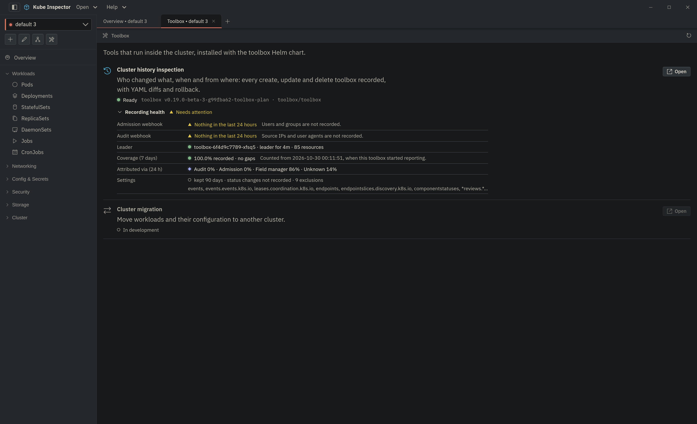

# Toolbox

**toolbox** is a small controller you install in a cluster. It records every
create, update and delete — **what** changed, **when**, and **who** did it from
**where** — into ClickHouse, and Kube Inspector reads that history to show it
as [Cluster History](cluster-history.md), per-object timelines with
[rollback](object-history.md), and a [recording health](recording-health.md)
summary.

Open it from the **tools** button in the cluster bar. The Toolbox tab lists the
in-cluster tools; each row says whether that tool is installed and reachable
with your access, and why not when it is not.

{ .doc-shot }

## What it records

Kubernetes has no single place that knows both what changed and who changed it,
so toolbox joins three sources:

| Source | Gives | Works on |
|---|---|---|
| **Informers** | the change itself: before/after, the changed fields, the field manager | every cluster |
| **Admission webhook** (always allows) | the user and their groups | every cluster, managed ones included |
| **Audit webhook** | source IP, user agent, impersonation, and requests the API server refused | clusters whose API server you configure |

Each change is matched to the request that made it. The **Via** column in the
history says which source answered: *Audit* (user, groups, IP, user agent),
*Admission* (user and groups), *Field manager* (only the name of the client
that wrote it) or *Unknown*.

Secret values are never stored: toolbox keeps a hash, so a diff shows *that* a
key changed, not to what.

## Installing

You need **cluster-admin** to install it. When toolbox is not on a cluster the
Toolbox tab shows this command with the cluster name filled in:

```bash
helm install toolbox oci://ghcr.io/opensourcemonkeys/charts/kube-inspector-toolbox \
  --namespace toolbox --create-namespace \
  --set-string clusterName='my-cluster'
```

This runs toolbox and a single-node ClickHouse in the `toolbox` namespace. The
admission webhook works straight away; users and groups are recorded from the
first change.

!!! tip "Your own ClickHouse"
    `--set clickhouse.enabled=false --set 'externalClickhouse.addr[0]=ch:9000'`
    (plus `externalClickhouse.existingSecret` for the password) uses a
    ClickHouse you already run. One ClickHouse can hold several clusters:
    `clusterName` tells them apart.

### Wiring the audit webhook

Source IPs, user agents and refused requests come from the API server's audit
log, which you can only configure on clusters where you run the control plane.

1. Add `--set audit.service.clusterIP=<a free IP in your service CIDR>` to the
   install, so the API server can reach toolbox by a fixed address.
2. Run `helm get notes toolbox -n toolbox`. It prints the audit policy and the
   webhook kubeconfig to put on each control-plane node, and the three
   `kube-apiserver` flags to add (`--audit-policy-file`,
   `--audit-webhook-config-file`, `--audit-webhook-batch-max-wait=5s`).
3. Restart the API server. The Toolbox tab's **Audit webhook** line turns from
   *Nothing in the last 24 hours* to a recent time once the first batch
   arrives.

### Managed clusters (EKS, GKE, AKS)

The API server is not yours to configure, so there is no audit webhook: no
source IPs, no user agents, and the **Rejected** view stays empty. Users and
groups are still recorded through the admission webhook.

## The access Kube Inspector needs

Kube Inspector reaches toolbox through the API server's service proxy with your
own kubeconfig, so nothing is port-forwarded and nothing is exposed. Your
account needs to:

- list Services (cluster-wide, or at least in the `toolbox` namespace),
- read the `toolbox` Secret in that namespace (it holds the API token),
- `get` the `services/proxy` subresource there.

Without them the Toolbox tab says **Forbidden** and names the missing verb on
hover. **Rollback** writes with your own credentials, so it needs the same
rights as editing that object.

## Upgrading

Upgrade with `helm upgrade toolbox oci://ghcr.io/opensourcemonkeys/charts/kube-inspector-toolbox -n toolbox --reuse-values`.
An older toolbox keeps working with a newer Kube Inspector: the parts it does
not support — recording health, the summary counts, the live stream — say so,
and everything else works as before.
