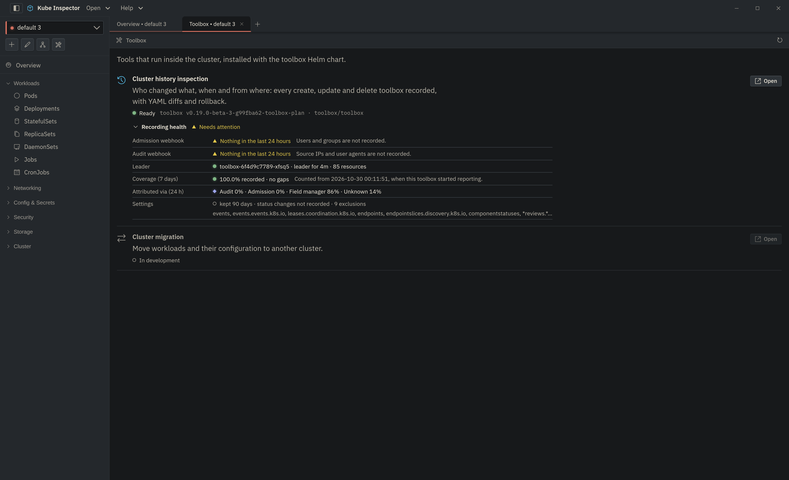

# Toolbox

The Toolbox tab holds tools that go beyond looking at a cluster. Open it from
the **tools** button in the cluster bar. Each row is one tool and says whether
it can be used on this cluster, and why not when it cannot.

{ .doc-shot }

| Tool | What it does | What it needs |
|---|---|---|
| [Cluster History](cluster-history.md) | Who changed what, when and from where, with YAML diffs and rollback | A controller installed in the cluster with Helm: [install it](history-install.md) |
| [Cluster Migration](cluster-migration.md) | Moves namespaces and their volume data to another cluster | Nothing installed: a second cluster added to Kube Inspector, and network between the two |

Every tool is managed from the desktop app and acts with your own kubeconfig, so
what you can do through one is what your account can do on that cluster.

The tools are in beta and have their own version line:
see [Versioning](../versioning.md#toolbox).
