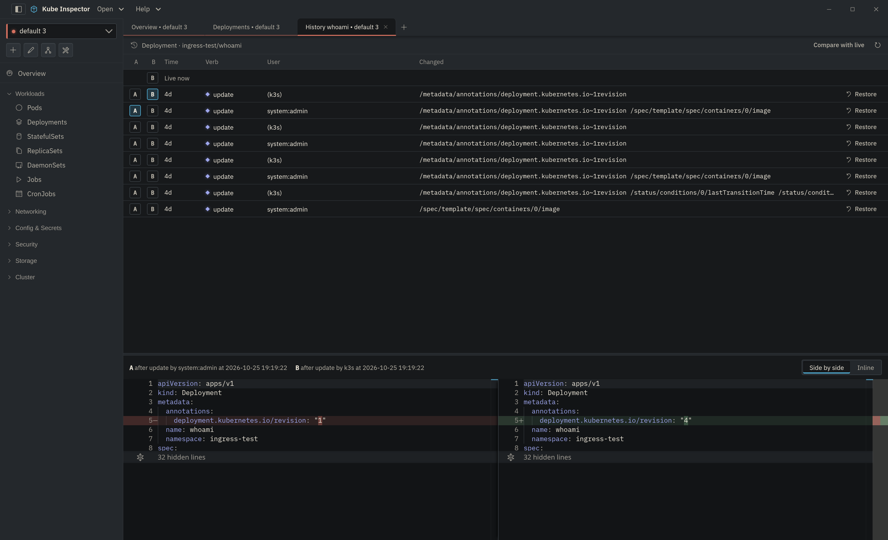

# Object history and rollback

Every list row's **⋮** menu, the YAML and Describe panels and the pod detail
have a **History** entry. It opens that object's timeline: every change toolbox
recorded to it, newest first.

{ .doc-shot }

The entry is greyed out, with the reason on hover, where toolbox is not
installed or not reachable with your access.

## Comparing versions

Each row has an **A** and a **B** key; the diff below the timeline compares the
object as it was after change **A** with the object after change **B**. The
**Live now** row at the top is the object as it is in the cluster right now —
**Compare with live** picks it as B.

Every version is shown without the fields the API server manages and without
status, so what you compare is what a rollback would write. An object deleted
and created again under the same name stays in one timeline, with a divider
where it was re-created. [Recording gaps](recording-health.md#recording-gaps)
show as dividers too: a change made then would be missing here.

## Rolling back

**Restore** on a row writes the object back as it was after that change. In
Cluster History, **Roll back** in a change's detail does the same for the
version on the diff's left.

1. The confirmation asks the API server first, with a **dry run** of exactly
   that write. Admission webhooks, quotas and validation answer here; if the
   server would refuse, the reason is shown and the confirmation cannot be
   accepted.
2. Confirming **replaces** the live object (fields added since that version are
   removed) and sends its current `resourceVersion`: if someone changes it in
   the meantime, the rollback fails instead of overwriting their change.
3. An object that no longer exists is created again. If its namespace is gone
   too, the dry run says so; create the namespace first.

After a rollback the list watches for the rollback's own change and marks it
when toolbox records it.

!!! warning "Things a rollback cannot do"
    - **Secrets** cannot be rolled back: toolbox never stores their values.
    - A **controller** that owns the object (a Deployment's ReplicaSets, an
      operator's resources) may change it straight back. Roll back the owner.
    - The version is read from toolbox by the app, never taken from what is on
      screen.

## In the terminal UI

The [CLI](../cli/index.md) has the same history under **CLUSTER ▸ Cluster
History**:

| Key | Does |
|---|---|
| `F` | filter on toolbox: `namespace=prod user=alice verb=update since=7d` (`since=all` for everything) |
| `M` | load the next 100 changes |
| `U` | undo the selected change: restore the version from before it. A dry run runs first; the confirmation names the object, the change, its author and the changed fields |
| `/` | search the loaded rows |
