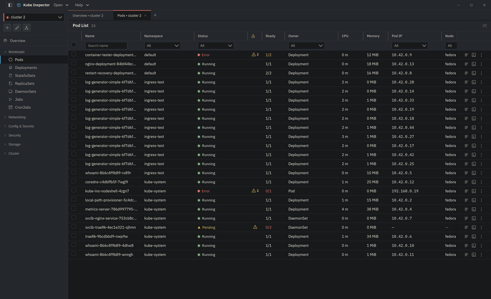

# Pods

The Pods screen lists all pods across all namespaces in the active cluster.

{ .doc-shot }

## Columns

| Column | Description |
|---|---|
| Name | Pod name |
| Namespace | Namespace the pod belongs to |
| Status | Running, Pending, CrashLoopBackOff, etc. |
| Ready | Container readiness count (e.g. `2/2`) |
| Restarts | Total restart count for all containers |
| Node | Node the pod is scheduled on |
| Age | Time since the pod was created |

## Actions

Per-row actions live in the **⋮** menu at the end of the row: **Describe** and
**Port forward**.

### Describe

**⋮ → Describe.** Opens `kubectl describe` output for the pod — container
states, conditions, volumes and, at the bottom, the pod's **events**, which is
where image-pull, scheduling and probe failures explain themselves. See
[Describe](../workspace/describe.md).

### Port forward

**⋮ → Port forward.** Tunnels a container port to `127.0.0.1`. A forward pinned
to a Pod does not follow the workload if that pod is replaced — forward the
Deployment or Service instead if you want it to survive a restart. See
[Port forwarding](../workspace/port-forwarding.md).

### View Logs

Click the **Logs** button on a pod row to open the [Log Viewer](../workspace/log-viewer.md) for that pod. Logs stream in real time.

### View YAML

Double-click a pod row to open its full YAML definition in a panel. Pod YAML is read-only (pods are ephemeral; edit the controlling resource such as a Deployment instead).

### Delete

Select one or more pods using the checkbox column and click **Delete Selected**, or use **Delete** in the pod detail panel. Confirm in the dialog. If the pod is managed by a controller, Kubernetes will recreate it.

The dialog offers two options, both off by default. They behave like the matching `kubectl delete pod` flags:

| Option | What happens |
|---|---|
| Neither | The pod shuts down within its own `terminationGracePeriodSeconds`. |
| **Force delete** | The pod is removed from the API at once, without waiting for the kubelet to confirm. Its containers may keep running on the node for a while. |
| **Grace period 0** | The containers are told to stop immediately and get 1 second to shut down, as kubectl does with `--grace-period=0`; the kubelet still confirms. |
| Both | Same as **Force delete**. |

## Tips

- Use the **Status** filter to quickly isolate failing pods (e.g., type `Crash` to find `CrashLoopBackOff` pods).
- Sort by **Restarts** descending to surface the most unstable pods.
